<h1 align="center">🌸 BloomGrid</h1>

<p align="center">
  <b>A solarpunk island city you grow, not just build.</b><br>
  Glass towers wrapped in living walls, highways of bio-turf, and a city that glows wherever its people are.
</p>

<p align="center">
  <a href="https://bloomgrid.web.app"><b>▶ Play in your browser</b></a> ·
  <a href="https://bloomgrid.web.app/assets/trailer.mp4">🎬 Watch the trailer</a> ·
  <a href="#-run-it-yourself">Run it yourself</a> ·
  <a href="#-how-to-play">How to play</a>
</p>

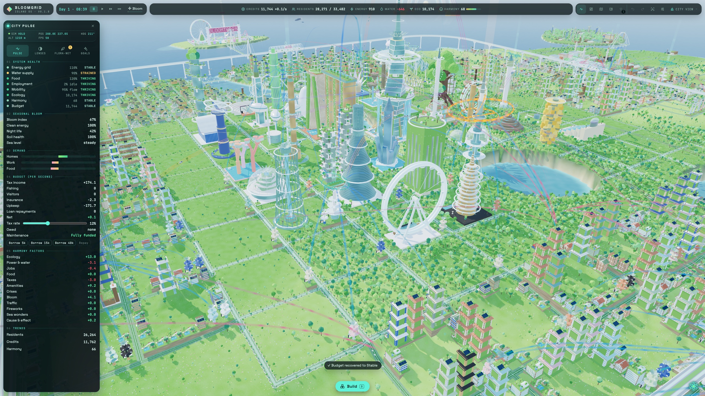

You are the **steward** of a Singapore-inspired island where high-tech architecture and wild nature grow together.
Lay living highways, raise garden towers and supertrees, and keep a city of 25,000 people powered, watered, fed and
happy. Through monsoons, heatwaves, king tides and a slowly rising sea, the island answers to how well you look after
it. Neglect it and the gardens wilt, the lights go out and the jungle takes the highways back.

## ✨ What makes it different

<table>
<tr>
<td width="50%">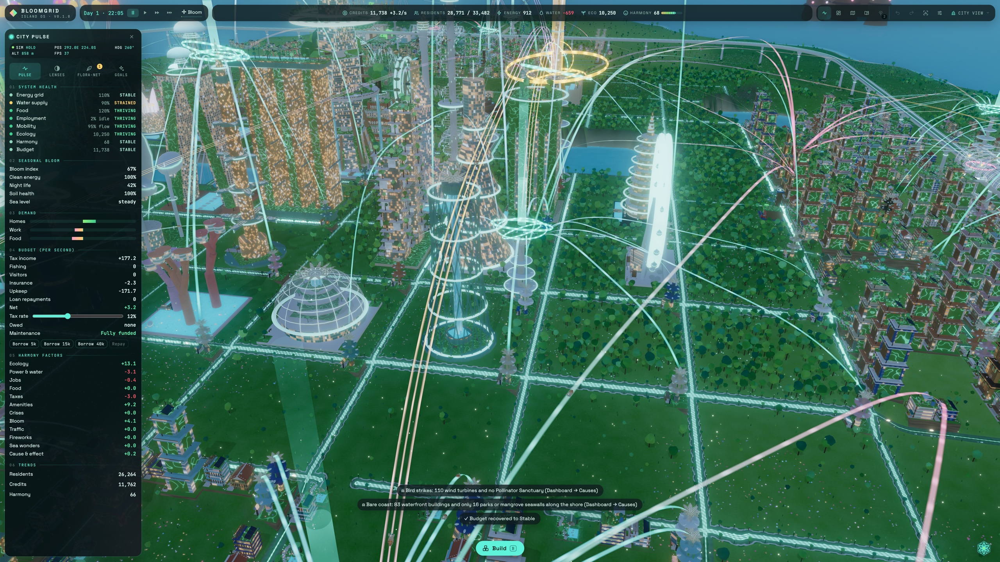</td>
<td width="50%">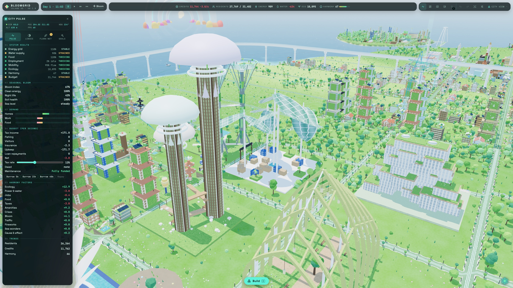</td>
</tr>
<tr>
<td><b>A city that glows with life.</b> At night, flowers, fungi paths and building veins light up wherever people
are out, so busy districts shine and quiet ones dim to embers.</td>
<td><b>Nature is infrastructure.</b> Supertrees make power, filtration channels clean water, pollinators lift
harvests, and every rooftop is a garden.</td>
</tr>
<tr>
<td>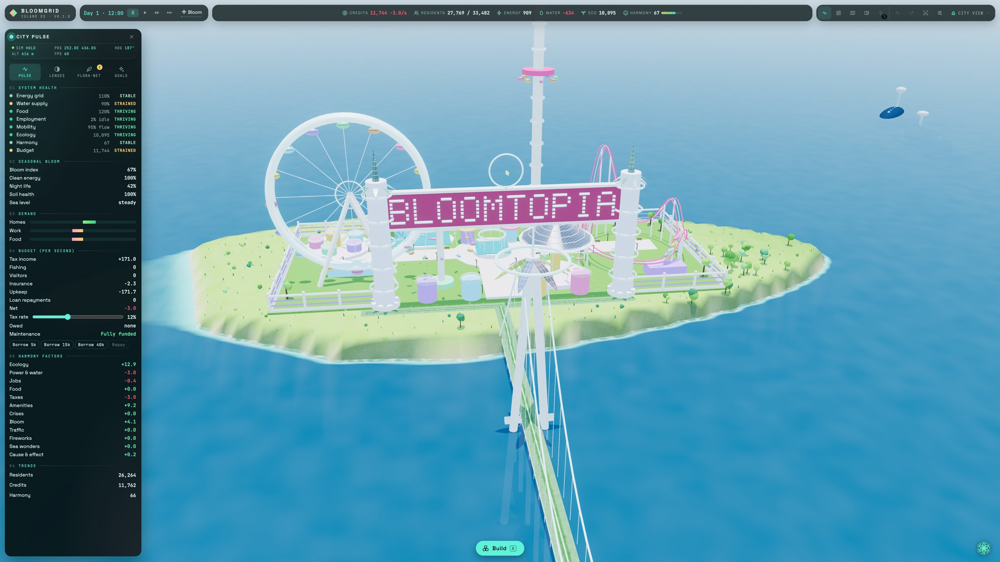</td>
<td>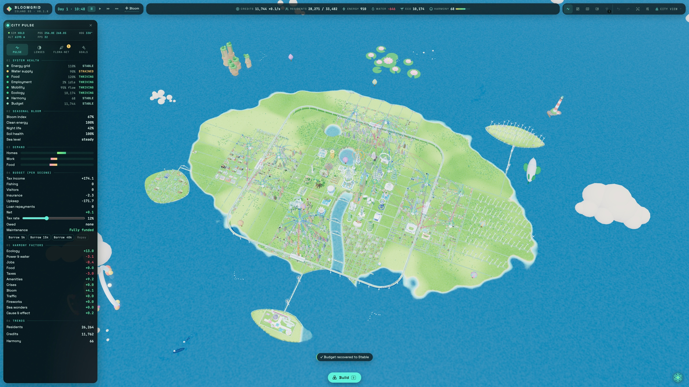</td>
</tr>
<tr>
<td><b>Landmarks worth visiting.</b> Bloomtopia's amusement park fills its own islet behind a neon gate — the Comet
Loop coaster, the Sky Orbit wheel, spinning Bloom Cups and a splash lagoon — and every long bridge becomes a
landmark of its own: suspension bridges with lotus or portal towers, a cable-stayed fan over the bay, Helix and
Bloom Arch bridges over the river.</td>
<td><b>A whole island to steward.</b> A 512 × 512 tile island with hills, lakes, a river and islets to bridge,
reclaim or defend — from the Tidewatch Lighthouse and glowing whale pods to a wind farm on Windward Isle.</td>
</tr>
</table>

## 🌆 Signature moments

<table>
<tr>
<td width="33%">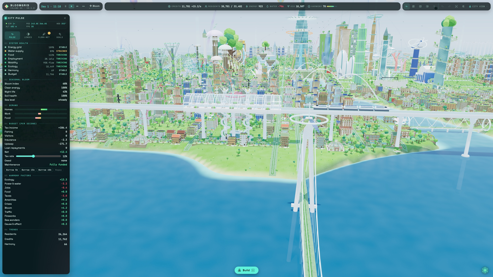</td>
<td width="33%">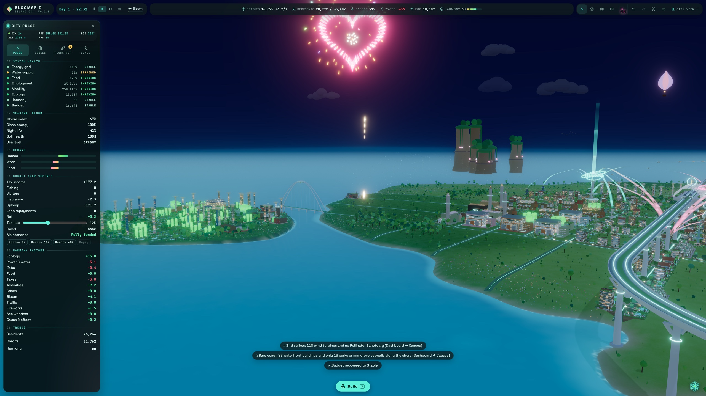</td>
<td width="33%">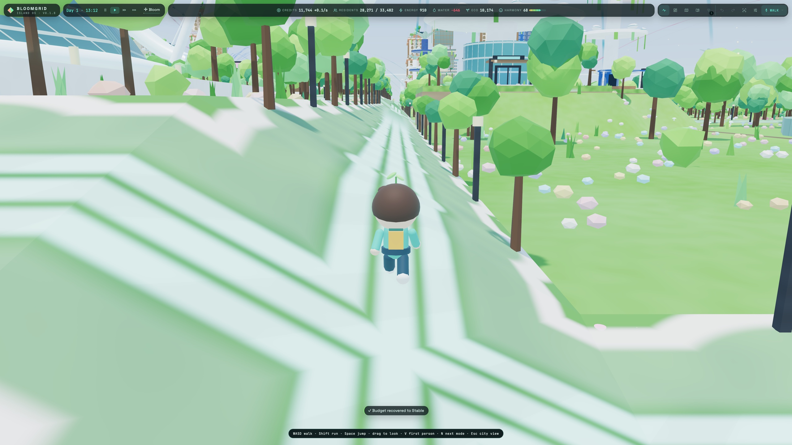</td>
</tr>
<tr>
<td><b>Ride the Aeroline.</b> A solar maglev loop on a viaduct of bloom pylons circles the island above the
streets, its sleek trains stopping at glass-vaulted stations in every town.</td>
<td><b>Fireworks you design.</b> Build a Fireworks Factory and light the night: peony, willow and palm shells,
hearts, rings and butterflies — even a message written in the sky.</td>
<td><b>Walk your streets.</b> Every district is real at street level: stroll the avenues, ride a commuter pod
along its sky-lane, or frame the moment in photo mode.</td>
</tr>
<tr>
<td>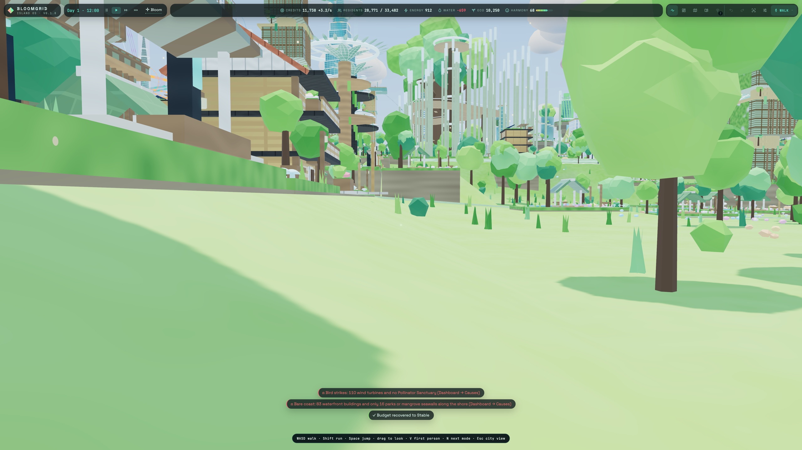</td>
<td>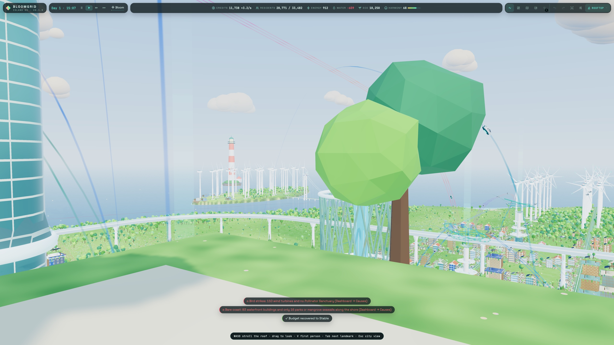</td>
<td>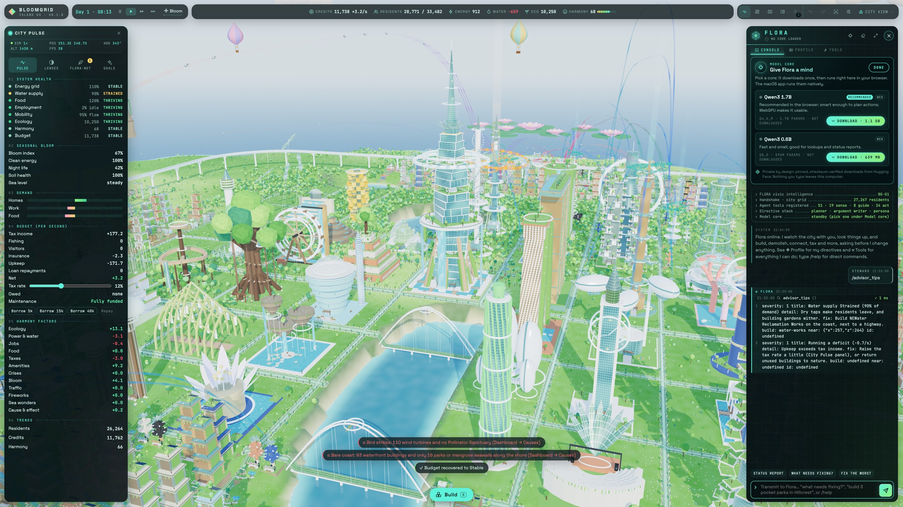</td>
</tr>
<tr>
<td><b>Every neighbourhood its own.</b> Terracotta with arched windows, whitewash with blue frames, rammed earth,
verdigris copper, glazed mosaic, charred timber, woven bamboo — and each landmark its own finish.</td>
<td><b>See it from anywhere.</b> Hoverboard, drone, hot-air balloon, landmark rooftops, a pod's chase view, a
train driver's cab, the bridge of the *Tidesong* cruise ferry or a chase cam behind the Sky Guard jet — the whole
island is yours to explore.</td>
<td><b>Meet Flora.</b> A city assistant running a small AI model on your own computer: ask what needs fixing, or
tell it what to do — it looks things up, proposes builds as cards, and asks before changing anything.</td>
</tr>
</table>

## 🌿 Systems that react to each other

- **Seasons and the Bloom.** Monsoon showers, golden harvests and dusty haze. Flowers open across the city as the
  bloom season peaks, and a **Bloom Retrofit** sends a wave of sunflower crowns and courtyard waterfalls through a
  district.
- **Commuters and traffic.** Residents travel to real jobs along your highways, and busy lanes jam. Green **Pod Docks**
  lift commuters over the traffic on glowing sky-lanes. **Pod Interchanges** and the central **Skylane Nexus** are
  hubs: they link nearby docks into one network, pods circle each hub's ring and route on to any lane, and docks on
  the network carry more riders. Hubs near an **Aeroline station** fly riders to its platform to change to the
  trains, which lifts the whole network again.
- **Living soil (Flora-Net).** Gardens dry out and farms exhaust their soil. Mist dry zones, dig channels, or build a
  **Drone Hive** whose hummingbird drones pollinate, harvest and trim the jungle back.
- **Crises.** Monsoons, king tides, heatwaves, algal blooms, grid failures and blight are forecast before they hit,
  so you have time to prepare. Debt leads to austerity, and austerity to decay.
- **A rising sea.** From day 3 the water creeps up. Plant **Mangrove Seawalls**, reclaim the shallows as new land,
  or let the coast go.
- **The Green Weaver.** Grow flowering sky-bridges between towers, or merge a tower with a giant banyan.

## 📊 Read your city like an instrument

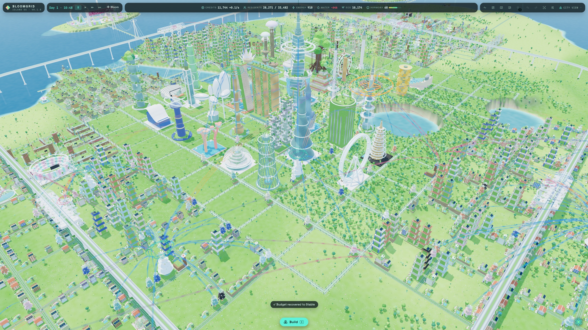

The **City Pulse** tracks energy, water, food, jobs, mobility, ecology and harmony. **Data lenses** recolour the
whole island by power, pollution, desirability, traffic, soil, flood risk or hazard **risk** (each building's exposure to
floods, fire, lightning, tornadoes and collapse; the inspector says why). The **Flora-Net advisor** points at
what is going wrong and offers a fix you can apply with one click.

## 🎮 How to play

Open the game, look around, and press **P** for the City Pulse. Then pick a problem the advisor flags and fix it.
Four difficulty levels range from a relaxed **Sandbox** to **Hard**.

| Do this            | Keys                                                                                               |
| ------------------ | -------------------------------------------------------------------------------------------------- |
| Move the camera    | **WASD** / arrows · right-drag or **Q/E** orbit · wheel zooms toward the cursor · a flicked drag glides on |
| About              | click **BloomGrid** at the top left for the credits: version, author, source link |
| Build              | **B** or the **Build** button (bottom centre) opens build mode: pick an action or a building category, then a building (a card explains the action, or shows the building's 3D preview, numbers and abilities) · while placing, a ring shows the area it serves and the tooltip gives the lot's land value and any pairing; an amber ghost fits but has a catch (e.g. no highway within 10 tiles) · **R** rotate · **Done**, **B** or **Esc** leaves (Esc or a right-click first puts down what is in hand) · a new building rises inside a blueprint of its finished size, with a tag counting down until it is **Ready**; its lot is graded to the street and rising ground beside it cut back to a ramp (undo puts the ground back) |
| Select & remove    | Click a building anywhere on it (roof, floors, or just beside it) to inspect it (who built it and the credits spent on it so far) · wheels and rides turn (the Great Noria, the Bloom Eye, Bloomtopia's Sky Orbit, carousel, swings, Bloom Cups, Petal Drop and balloon ride, the Helix Spire's rotor), each with **Stop / Start** in its inspector, and the Bloom Clock's hands keep the city's time · every hero and landmark's inspector has **Sky deck** (stand on top and stroll round it) and **Postcard** (a framed view in photo mode); the Aurora Gemini adds a **Light show** · click a bridge for its own panel: name, type, the districts it links, length, age, traffic, capacity, builder, and **Upgrade** (Standard → Lantern → Grand) · **Ctrl/⌘-drag** a box to select every building of one type inside it (the type under where you start) · **Delete** (or ⌫) returns the selection to nature, as does the inspector's *Return to nature* (one undo restores it all) |
| Move a building    | **Shift-drag** a building to a new lot (green ghost = it fits) · **R** rotates while carrying · **Esc** cancels · costs 10% of its price and keeps its level, age and id (one undo) |
| Lay infrastructure | Build → **Highway** (drag across water and it bridges bank to bank, grading a steep bank into a ramp; the tooltip says if any tile is skipped and why; starts as a raw track; traffic paves it into a Living Highway and busy ones grow into Bloom Boulevards; click one to upgrade a stretch) · Build → **Channel** (filtration)                                                    |
| Grow and heal      | Build → **Retrofit**, **Mist** (Flora-Net), **Weave** (Green Weaver), **Reclaim** land (build actions have no hotkeys; click them in the Build panel)              |
| Notices            | Every toast, alert card (fires, tornado / tsunami warnings, crises, the council warning) and residents' request has a ✕ to close it; hovering a toast holds it |
| Watch your city    | Hover any number in the top bar (credits, residents, energy, water, ecology, harmony) for what it means and the best move; click it for the breakdown, the trend and one-click fixes (build, lens, tax, loan, suggested builds) · **P** (or the pulse button at the left of the top bar's actions) shows / hides the City Pulse console (folded at launch) (**Esc** folds it once nothing else is open) (tabs: Pulse, Lenses, Flora-Net, Goals; on phones, separate sheets) · **L** data lenses (each explained in City Pulse → Lenses; **Esc** or ✕ on the legend turns one off) · **F** Flora-Net tab · **K** dashboard · **I** inventory · **O** overview · **M** city map (the map button in the top bar's actions: every district named; click one to fly there) |
| Milestones & tips  | On a fresh island the card at the top right (above **Build** on a phone) shows your next milestone and a **Build** shortcut; once reached it glows: **Claim** the credits (the Goals tab lists the next few) · pop the gold **tip bubbles** that float over happy buildings for a small tip and a word from the residents; quick pops make a combo (up to ×5). Bubbles can be turned off in ⚙ Settings → Display |
| Requests & happenings | Now and then residents ask for a building nearby, or a festival, cruise visit or bumper catch comes up: a card at the top right shows what, where and the time left · **Build** picks a fitting building, **Locate** shows the spot, **Claim** collects an answered request's reward |
| Learn             | **?** or **F1** Seedvault: guides, incident runbooks, live reference and your field logs and notes |
| Ask for help       | **U** Flora, the city assistant · **Shift+U** maximize her console · **Esc** or ✕ closes it · type **/** for commands (Tab completes) (the glowing orb bottom-right, **Ask Flora** on any selected object: it loads a downloaded model if none is running) |
| Ferry and jet      | click the *Tidesong* cruise ferry (or its pier by Bloomtopia) for its voyage, timetable and facilities: **Depart now**, **Full ahead** (double speed to the end of the voyage), **Charter** the next voyage to any risen sea wonder, **Deck show**, **Horn**, **Ride aboard**, **Locate** · click the BloomGrid Sky Guard jet for **Chase cam**, **Victory roll**, **Afterburner** and **Display smoke** |
| Explore            | in walk, drone and the other views the island comes alive up close: people on the pavements, butterflies (fireflies at night), rabbits in the meadows, fish in the water and flocks of birds ·  phones: the ◇ button in the top bar picks a view; a joystick moves, ▲ ▼ rise and sink, and the top bar hides so only the round **◇** (top-left) is left to return to the city view · **N** walk / hoverboard / drone / balloon / rooftop / ride a pod / ride the Aeroline / sail the cruise ferry / chase the Sky Guard jet (**Tab** next pod, train or landmark; **V** first person or the balloon's basket view; **Esc** back) · walking, a card names the building in reach: **E** opens its door (walk into the Mycelium Work Dome), **L** switches its lights · up close, buildings show their name over the entrance and their id on the door, and residents walk in and out · **J** photo mode (**P** saves a PNG); or the ◇ view-mode menu at the end of the top bar (**Esc** closes it) |
| Find a fire        | **.** fly to the next fire (⌖ Next in the fire panel) · click a 🔥 pin, an alert toast or a map pin |
| Time               | **Space** pause · **1 / 2 / 3** speed; in the top bar, click the day dial to pause / play and the speed chip for the next speed (1× → 3× → 8×; right-click or scroll: slower); hover the season chip beside it for the weather, click it for the season's effects, crisis odds, the season ahead and one-click ways to prepare. Pausing opens a pause card (Resume, the city at a glance, what needs attention); **Esc** or a click on the city folds it to a pill. No context menu in the game |
| Undo, save, load   | **⌘Z** / **⇧⌘Z** · **⌘S** / **⌘L** (Ctrl on Windows/Linux), or ⚙ Settings → Game (shows the saved city and when; Load asks before replacing the city) |
| Remember a view    | **Alt+1–4** store · **Shift+1–4** recall                                                           |
| Sound              | **,** mute / unmute · volumes for music, ambience and effects in ⚙ Settings (sound starts on your first click); trains, pods and fires are heard close up |

**On a phone:** drag to pan, pinch to zoom, twist to rotate, drag two fingers up or down to tilt. Tap a building to
inspect it. To build, tap **Build** (bottom), pick a category and a building, tap the map to preview, then tap the preview again (⟳ rotates); **Done** leaves build mode. The top
bar's Pulse button opens City Pulse, the same console as on desktops with Pulse, Lenses, Flora-Net and Goals
(unlock projects, sea wonders, fishing) tabs; tap the button, ✕ or the city to close it. The logo at the top left
opens About. The HUD shows less on a phone
(no telemetry strip or explore modes), and phones start on Medium graphics. Flora is the glowing orb beside the
Build button; her console opens full-screen.

**Flora** (**U**): a city assistant that runs a small AI model on your own computer. Ask it what needs fixing,
or tell it what to do ("build three vertical farms in Bayfront", "fix the power problem in Bayfront", "set taxes to
14%", "how is our budget?", "pause", "show the water lens"): it looks things up, then asks before changing anything, and every action can be undone with **⌘Z**. Pick
a model under ⚙ (it downloads once from Hugging Face, ≈0.6–1 GB; on an Apple Silicon Mac the desktop app runs it
natively, much faster). Without a model, slash commands work: type `/help`. The **Autonomous mode** switch in the Profile tab lets her act without asking. Clear the chat with the eraser in her header (or `/clear`): earlier messages are then no longer sent to the model. The log keeps the latest 40 entries; older ones fade away. The **◈ Profile** tab shows who Flora
is and the exact instructions (system prompts) her model gets each turn, plus the live city brief she reads; the
**⚒ Tools** tab lists every tool she can use, with its parameters, and lets you run one directly. Ask *"what should we build next?"* (or for advice, or why something is failing) and she diagnoses the
city and proposes concrete builds as cards: what, how many, where, why and what it achieves. **Build** on a card
places them with one click (undoable), **Lot** shows the spot first, and once built each new building gets a
**Locate** chip that flies you there. When a system drops, her alert already carries the cards. She also acts on many buildings at once: *"turn off all wind turbines"*, *"start all wind turbines"*,
*"renovate all canopy towers in Westbrook"*, *"upgrade the old homes in Bayfront"* (one ⌘Z undoes the lot, and the
buildings she changed get Locate chips). Founding a new island or loading a save starts a fresh conversation.

**Seedvault** (**?** or F1, or the book in the top bar): the city's knowledge base. Guides to every system, what
causes what, step-by-step incident runbooks (fires, quakes, floods, blackouts, tornadoes, tsunamis, debt, the fail
clock…), playbooks, and a live reference generated from the game's own rules. It also keeps a journal on your device:
your notes, and field logs the city writes itself after every incident, consequence and recovery (what it cost, what
helped, what you did to fix it), so lessons carry over to every city you found. Flora reads it too: ask her *"how do
I stop fires spreading?"* and she finds the runbook, reads the right section and answers; *"remember that…"* saves a
note. In the desktop app the journal is a folder of Markdown files (app data `knowledge/`) you can edit or add to.

**Inventory** (**I**): every building, highway network, bridge, sky-bridge, channel, district and sea wonder, each
with a readable id such as `LIV-0042` or `HWY-118.204`. Search by name, id or district, or filter with `issue:power`,
`status:critical`, `district:westbrook`, `is:old`, `is:upgradable`, `is:top` (or the age / level menu, and sort by
Oldest or Level); pick a row to inspect it and **Locate** to fly there: the camera climbs and comes down over it from above, so it is never hidden behind towers, and a glowing reticle and marker show what is selected. The inspector shows
the id of whatever you select; click it to open the inventory.

**A planned city:** every area has a purpose: living, work, industry, entertainment, sports, utility, civic and
parkland. Open the city map (**M**) to see the zones in colour (toggle to per-district colours); the inspector
shows the zone of whatever you select. Factories (Industry ⚙) and venues like Bloom Stadium (Sports ✪) are the
last two build categories. Pod Interchanges in the living towns fly commuters to the work and industry zones. At
the island's heart rise the **Aurora Gemini** twin towers: identical round glass towers ringed by spiralling light ribs
and sky-garden lawns, joined by a garden bridge and a sky-pool bridge with a waterfall, with the Sun Gate, a golden
ring of rays, hung between their spires. The **Aegis Watch Precinct**, the island's police headquarters in The Exchange, keeps two patrol drones on its
roof (**Dispatch drones** sends them up on a sortie). The city's heavy police drone stands on a pad in the Harmony Gate's roof
garden, and a wing of small patrol drones circles the bay, banking into their turns, light bars flashing and
searchlights sweeping the water after dark. Select them for a **Light show** (searchlights and an aurora over the
city); like every hero, they also have a **Sky deck** and a **Postcard** view. Around them lies the **hero district**: a civic ring of wind helix, hanging-gardens
ziggurat, sky-ark, cloud-forest domes, a crystal data spire, a nautilus library and the Harmony Gate; a skyline hill of
towers; an exchange of airship port, labs, observatory and amphitheatre; a garden quarter of banyan treehouse hotel,
bamboo cathedral and moonflower concert hall; and working hills by the lake with rice terraces, solar kites and a
great water wheel beside the Wellspring Spire — with empty graded lots left for your city to grow into.

**Disasters:** earthquakes, thunderstorms that throw lightning at tall buildings, and fires (from quakes,
lightning, heatwaves and factories) that spread if nobody fights them. Ember Watch Stations put out fires within
reach on their own; elsewhere, dispatch crews from the fire panel or the inspector (◈150 a fire), or ask Flora
("put out the fires", "what is burning?"). Burned-out buildings become ruins until you rebuild them. Every crisis
and fire is recorded with its losses in the dashboard's **Incidents** tab (**K**, then Incidents). Every fire
raises a beam of light and pulsing rings you can see from across the island, and a 🔥 pin that slides to the screen
edge (pointing at it) when the fire is out of view; click a pin, an alert toast or a fire on the city map (**M**) to
fly there, or press **.** to step through the fires, hottest first.

**A new chapter:** the game opens on the New Chapter dialog: **Resume** your saved city (the default when you have
one), found a **New island** (name it, roll another name, choose how hard the world pushes back) or browse the
**Showcase** city, already built. The city waits while you choose; Enter takes the highlighted choice. Founding or
loading a city plays behind a full-screen loading screen with its real stages and a tip, then opens onto the city. A new island
starts as a fishing hamlet, and the guide walks you through the first steps (⚙ Settings → How to play reopens it;
**H** or Settings → Controls shows every control). Early on, **Fishing Boat Docks** (free; Build → Food; must touch the sea, and turn to face it by themselves until you press R) pay the bills:
two or three fish the sea best, more overfish it, and a polluted coast spoils the catch. The **Goals** tab in City
Pulse lists what to unlock next: the *Sky-lane charter* (pod docks), the *Aeroline* and *Wake Flora* (the city
assistant needs a power plant and a Data Spire, and each request then costs credits), plus the sea wonders still
to be discovered: they rise from the sea as your city earns them. While Flora sleeps her orb is dim with a "z": open
it to see what she still needs, each with a **Build** button; when it pulses *Ready to wake*, wake her and watch her
come online over the Data Spire.

**Fireworks:** build a Fireworks Factory (Industry ⚙). Staffed and powered, it makes peony, willow, halo ring,
palm and crackle shells (materials cost credits) and fires a show over the city every night at 21:00. Launch one
yourself any time with the fireworks button in the top bar (it shows the shells in stock; shift-click for a grand
show), from the dashboard's **Fireworks** tab (**K**, then Fireworks: stock, shows so far, effects, nightly on/off),
or ask Flora ("launch the fireworks", "how many fireworks shows have we had?"). Shows mix in shaped shells:
hearts, the five Olympic rings and butterflies. Ask Flora for a message in the sky ("fireworks that say HAPPY
BIRTHDAY") or type `/launch_fireworks text="I <3 BLOOMGRID" shape=heart grand=true` in her console (up to 18
letters, digits, spaces, ♥ and ! ? & - +; `shape` = heart, rings or butterfly). Shows lift harmony and draw visitors,
but the smoke adds pollution, dry nights risk a stray spark setting a roof alight, and shows fired back to back stop
delighting residents and start to annoy them.

**Wind power:** Breeze Turbines (☀ energy category) are cheap, clean and the cheapest power to run. The founding
city already runs on them: a wind farm fills Windward Isle in the north-east and rows line the waterfront.

**Moments:** the big events of your city's life play as short full-screen ceremonies: Flora waking, the Sky-lane
charter and the Aeroline opening, a sea wonder rising, population milestones, a golden age (every system thriving),
a disaster weathered, your first top-level building. Click or Esc skips one; ⚙ Settings → Display → Moments picks
all, major only or off.

**Settings** (⚙ in the top bar): graphics quality, and a power mode (Battery 30 fps · Balanced 60 fps · Max) that
keeps laptops cool. The game idles at a lower frame rate when nothing moves.

**Runs on:** any recent Chrome, Edge or Safari. It uses WebGPU where available and falls back to WebGL2 automatically.

## 🚀 Run it yourself

You need [bun](https://bun.sh) (and a Rust toolchain only for the desktop app).

```bash
git clone https://github.com/shoocstorm/BloomGrid.git
cd BloomGrid
bun install
bun run dev        # then open http://localhost:3000
```

**macOS app:** download the `.dmg` from the latest [GitHub Release](https://github.com/shoocstorm/BloomGrid/releases/latest)
(`aarch64` for Apple Silicon, `x64` for Intel) and drag BloomGrid to Applications. If macOS blocks the first launch,
click **Open Anyway** in System Settings → Privacy & Security.

**Desktop app:** `bun run tauri:dev` opens BloomGrid in a native window (Tauri v2), and `bun run tauri:build`
packages it. Saves are JSON files in the app data folder, and ⚙ → Display → Window toggles fullscreen (F11).

<details>
<summary><b>Handy URL flags</b></summary>

`?quality=low|medium|high|ultra` · `?renderer=webgl` (force the WebGL2 fallback) · `?scenario=empty` (a blank island
instead of the founding city) · `?difficulty=sandbox|relaxed|steward|hard` · `?seed=123` (a different island) ·
`?drill=monsoon|king-tide|heatwave|algal-bloom|grid-failure|blight` (start a crisis) · `?happening=request|festival|bumper-catch|cruise` (start a happening) · `?perf` (performance overlay,
also **F3**) · `?stress=2000` (add a stress city) · `?nodynres` · `?gputime` · `?pr=1 ?msaa=0 ?shadows=0 ?bloom=0`
(quality overrides).

</details>

## 🛠 For contributors

BloomGrid is TypeScript + [three.js](https://threejs.org) (WebGPU with a WebGL2 fallback, TSL materials), built with
Vite, with a deterministic, fully tested simulation.

```bash
bun run check      # typecheck + lint + tests + production build
bun run test       # Vitest: sim determinism, undo/redo, save/load (not `bun test`)
bun run snap -- --out shots/x.png   # headless screenshot (dev server must be running)
bun run perf                        # power/perf probe: main-thread %, fps, CPU/GPU ms per frame
bun run release    # bump the version, tag vX.Y.Z and push; GitHub Actions deploys to Firebase Hosting
```

Releases: `bun run release [patch|minor|major|X.Y.Z]` (add `--dry-run` to preview). Pushing the tag runs the
`firebase-hosting-release` workflow, which checks, builds and deploys the live site.

- [`AGENTS.md`](AGENTS.md): how to work on this repo (rules, commands, definition of done, releasing)
- [`BloomGrid_Implementation_Requirements-v3.md`](BloomGrid_Implementation_Requirements-v3.md): canonical requirements
- [`docs/progress.md`](docs/progress.md): handoff snapshot (where things stand, what's next)
- [`docs/roadmap.md`](docs/roadmap.md): phases and status
- [`docs/architecture.md`](docs/architecture.md): layers and extension points
- [`docs/decisions.md`](docs/decisions.md): decision log

Every model is procedural (kit pieces built in code), including the hero landmarks. Every building grows its own
designed additions at levels 2 and 3 (a storey and a lifted roof, new tower segments, a treehouse, an upper stand, a
taller spire), and weathers with age and lights its windows like the rest of it.
