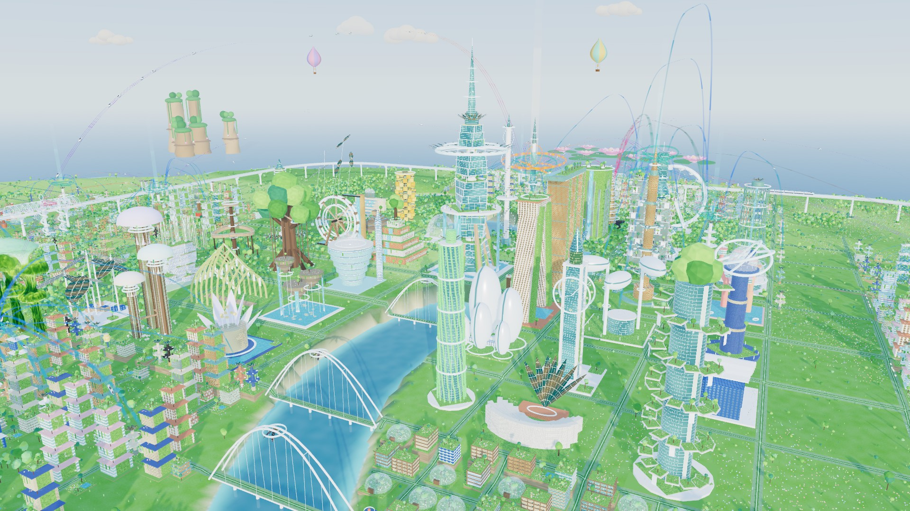
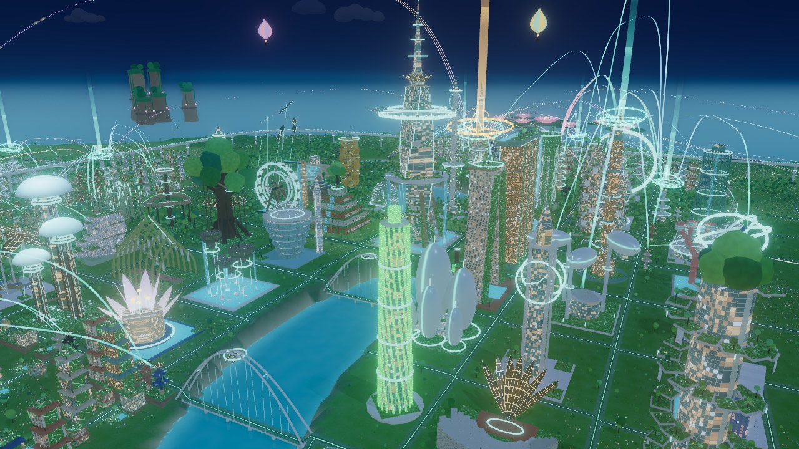
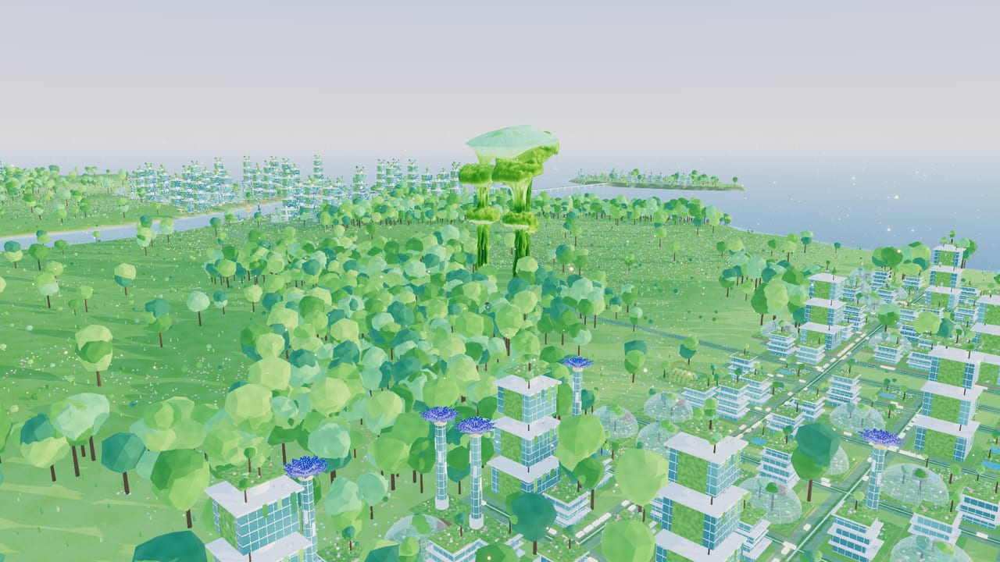
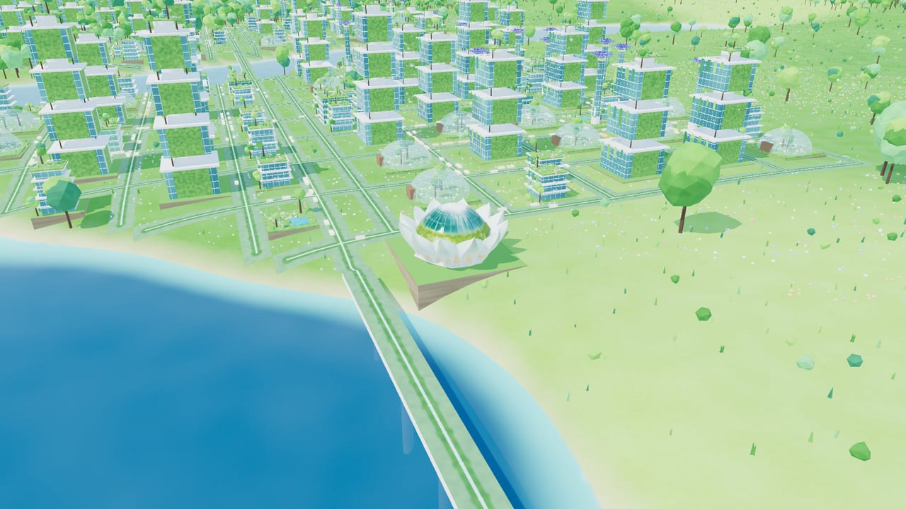
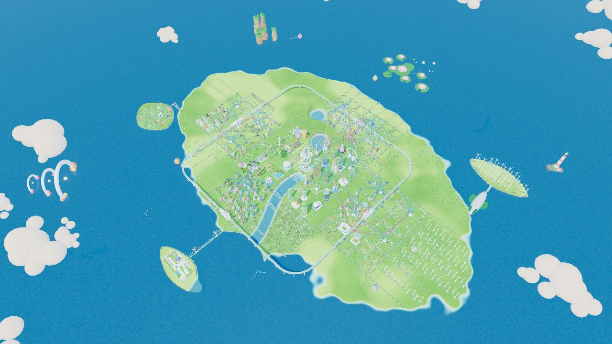
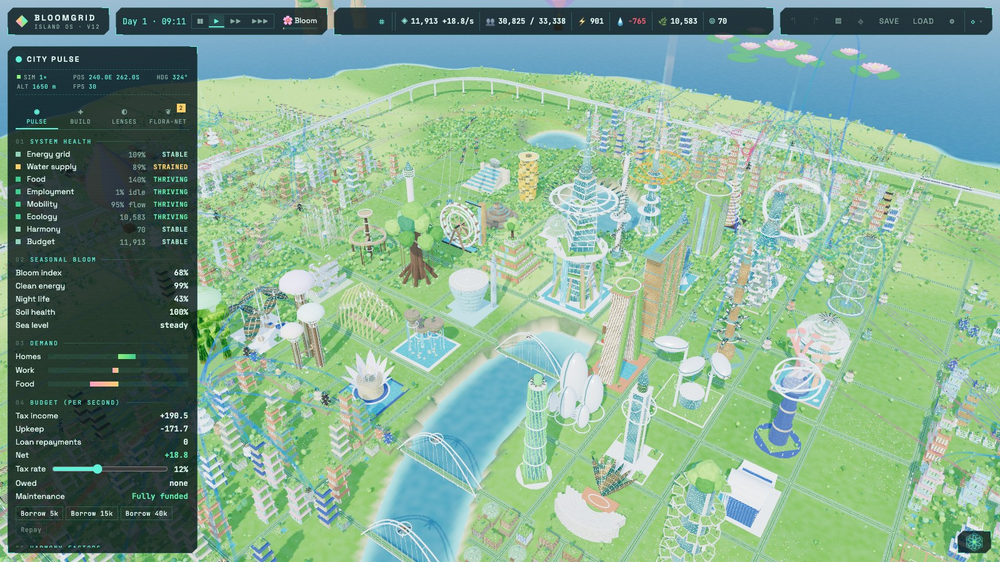

<h1 align="center">🌸 BloomGrid</h1>

<p align="center">
  <b>A solarpunk island city you grow, not just build.</b><br>
  Glass towers wrapped in living walls, highways of bio-turf, and a city that glows wherever its people are.
</p>

<p align="center">
  <a href="https://bloomgrid.web.app"><b>▶ Play in your browser</b></a> ·
  <a href="#-run-it-yourself">Run it yourself</a> ·
  <a href="#-how-to-play">How to play</a>
</p>



You are the **steward** of a Singapore-inspired island where high-tech architecture and wild nature grow together.
Lay living highways, raise garden towers and supertrees, and keep a city of 25,000 people powered, watered, fed and
happy. Through monsoons, heatwaves, king tides and a slowly rising sea, the island answers to how well you look after it.
Neglect it and the gardens wilt, the lights go out and the jungle takes the highways back.

## ✨ What makes it different

<table>
<tr>
<td width="50%"></td>
<td width="50%"></td>
</tr>
<tr>
<td><b>A city that glows with life.</b> At night, flowers, fungi paths and building veins light up wherever people
are out, so busy districts shine and quiet ones dim to embers.</td>
<td><b>Nature is infrastructure.</b> Supertrees make power, filtration channels clean water, pollinators lift
harvests, and every rooftop is a garden.</td>
</tr>
<tr>
<td></td>
<td></td>
</tr>
<tr>
<td><b>Landmarks worth visiting.</b> The whole island is one planned city: Bayfront down the river to the bay,
Eastgate, Westbrook and Hillcrest of green-courtyard blocks, and the Sunfield solar farm. The Wellspring Spire rises at
its heart where the river is born, at the centre of the hero district: a civic ring (wind helix, hanging-gardens ziggurat, sky-ark, cloud-forest domes, a
crystal data spire, a nautilus library and the Harmony Gate), a skyline hill of towers, a skyport, a glass pine and an
observation wheel, an exchange of airship port, labs, observatory and amphitheatre toward downtown, a garden quarter of
a banyan treehouse hotel, a bamboo cathedral and a moonflower concert hall, and working hills by the lake with rice
terraces, solar kites and a great water wheel, with empty graded lots left for the city to grow into. Across the bridge south of downtown, **Bloomtopia** fills its own
islet behind a railing fence and a neon gate: the Comet Loop coaster, the Sky Orbit wheel, the Petal Drop tower, a
dandelion swing ride, the Firefly Carousel, spinning Bloom Cups and a splash lagoon. Every long bridge becomes a
landmark of its own: suspension bridges with lotus or portal towers over the straits, a cable-stayed fan over the
bay, and Helix or Bloom Arch bridges over the river and lake (bridges you build get them too). Clouds drift over
the island (parting around wherever you look), lantern balloons and a leaf-sailed airship circle it, seabirds wheel
over the coast, and the open sea holds its own wonders: the Tidewatch Lighthouse sweeping its beam at night, the Tide
Gates (three giant pearl rings rising from the waves), the Lotus Atoll of giant floating flowers, the Abyssal Dome
observatory, the Verdant Pillars (forested sea stacks) and pods of glowing whales that surface now and then. Every
neighbourhood has its own architecture: terracotta with arched windows, whitewash with blue frames, rammed earth,
verdigris copper, glazed mosaic, charred timber, limestone, woven bamboo and more, and each landmark its own finish. The
**Aeroline**, a solar maglev loop on a viaduct of bloom pylons, circles the hero district above the streets of all four
towns and out over the bay, its sleek trains stopping at glass-vaulted stations in Hillcrest, Eastgate, Bayfront and
Westbrook (each a transit hub that takes commuters off the highways, boarded by Bloom Helix towers: planted
spiral walkways wound round glass lifts). Walk, hoverboard or fly a drone through your
streets, ride a commuter pod along its sky-lane or an Aeroline train round the island, or frame the moment in photo mode.</td>
<td><b>A whole island to steward.</b> A 512 × 512 tile island with hills, lakes, a river and islets to bridge,
reclaim or defend.</td>
</tr>
</table>

### 🌿 Systems that react to each other

- **Seasons and the Bloom.** Monsoon showers, golden harvests and dusty haze. Flowers open across the city as the
  bloom season peaks, and a **Bloom Retrofit** sends a wave of sunflower crowns and courtyard waterfalls through a
  district.
- **Commuters and traffic.** Residents travel to real jobs along your highways, and busy lanes jam. Green **Pod Docks**
  lift commuters over the traffic on glowing sky-lanes.
- **Living soil (Flora-Net).** Gardens dry out and farms exhaust their soil. Mist dry zones, dig channels, or build a
  **Drone Hive** whose hummingbird drones pollinate, harvest and trim the jungle back.
- **Crises.** Monsoons, king tides, heatwaves, algal blooms, grid failures and blight are forecast before they hit,
  so you have time to prepare. Debt leads to austerity, and austerity to decay.
- **A rising sea.** From day 3 the water creeps up. Plant **Mangrove Seawalls**, reclaim the shallows as new land,
  or let the coast go.
- **The Green Weaver.** Grow flowering sky-bridges between towers, or merge a tower with a giant banyan.

### 📊 Read your city like an instrument



The **City Pulse** tracks energy, water, food, jobs, mobility, ecology and harmony. **Data lenses** recolour the
whole island by power, pollution, desirability, traffic, soil or flood risk. The **Flora-Net advisor** points at
what is going wrong and offers a fix you can apply with one click.

## 🎮 How to play

Open the game, look around, and press **P** for the City Pulse. Then pick a problem the advisor flags and fix it.
Four difficulty levels range from a relaxed **Sandbox** to **Hard**.

| Do this            | Keys                                                                                               |
| ------------------ | -------------------------------------------------------------------------------------------------- |
| Move the camera    | **WASD** / arrows · right-drag or **Q/E** orbit · wheel zoom                                       |
| Build              | **4–0** building categories · **R** rotate · **X** bulldoze                                        |
| Lay infrastructure | **G** living highway · **C** filtration channel                                                    |
| Grow and heal      | **B** Bloom Retrofit · **M** Flora-Net mist · **V** Green Weaver · **T** reclaim land              |
| Watch your city    | **P** City Pulse · **L** data lenses · **F** advisor · **K** dashboard · **I** inventory · **O** overview |
| Ask for help       | **U** Flora, the city assistant (✿ in the top bar, **✿ Ask** on any selected object) |
| Explore            | **N** walk / hoverboard / drone / ride a pod / ride the Aeroline (**Tab** next, **Esc** back) · **J** photo mode (**P** saves a PNG) |
| Time               | **Space** pause · **1 / 2 / 3** speed                                                              |
| Undo, save, load   | **⌘Z** / **⇧⌘Z** · **⌘S** / **⌘L** (Ctrl on Windows/Linux)                                         |
| Remember a view    | **Alt+1–4** store · **Shift+1–4** recall                                                           |

**Flora** (**U**): a city assistant that runs a small AI model on your own computer. Ask it what needs fixing,
or tell it what to do ("build a water works in Westbrook", "fix the power problem in Bayfront", "set taxes to
14%"): it looks things up, then asks before changing anything, and every action can be undone with **⌘Z**. Pick
a model under ⚙ (it downloads once from Hugging Face, ≈0.6–1 GB; on an Apple Silicon Mac the desktop app runs it
natively, much faster). Without a model, slash commands work: type `/help`.

**Inventory** (**I**): every building, highway network, bridge, sky-bridge, channel, district and sea wonder, each
with a readable id such as `LIV-0042` or `HWY-118.204`. Search by name, id or district, or filter with `issue:power`,
`status:critical`, `district:westbrook`; pick a row to inspect it and **Locate** to fly there. The inspector shows
the id of whatever you select; click it to open the inventory.

**Settings** (⚙ in the top bar): graphics quality, and a power mode (Battery 30 fps · Balanced 60 fps · Max) that
keeps laptops cool. The game idles at a lower frame rate when nothing moves.

**Runs on:** any recent Chrome, Edge or Safari. It uses WebGPU where available and falls back to WebGL2 automatically.

## 🚀 Run it yourself

You need [bun](https://bun.sh) (and a Rust toolchain only for the desktop app).

```bash
git clone https://github.com/shoocstorm/BloomGrid.git
cd BloomGrid
bun install
bun run dev        # then open http://localhost:5173
```

**Desktop app:** `bun run tauri:dev` opens BloomGrid in a native window (Tauri v2), and `bun run tauri:build`
packages it. Saves are JSON files in the app data folder, and ⚙ → Window toggles fullscreen (F11).

<details>
<summary><b>Handy URL flags</b></summary>

`?quality=low|medium|high|ultra` · `?renderer=webgl` (force the WebGL2 fallback) · `?scenario=empty` (a blank island
instead of the founding city) · `?difficulty=sandbox|relaxed|steward|hard` · `?seed=123` (a different island) ·
`?drill=monsoon|king-tide|heatwave|algal-bloom|grid-failure|blight` (start a crisis) · `?perf` (performance overlay,
also **F3**) · `?stress=2000` (add a stress city) · `?nodynres` · `?gputime` · `?pr=1 ?msaa=0 ?shadows=0 ?bloom=0`
(quality overrides).

</details>

## 🛠 For contributors

BloomGrid is TypeScript + [three.js](https://threejs.org) (WebGPU with a WebGL2 fallback, TSL materials), built with
Vite, with a deterministic, fully tested simulation.

```bash
bun run check      # typecheck + lint + tests + production build
bun run test       # Vitest: sim determinism, undo/redo, save/load (not `bun test`)
bun run snap -- --out shots/x.png   # headless screenshot (dev server must be running)
bun run perf                        # power/perf probe: main-thread %, fps, CPU/GPU ms per frame
bun run release    # bump the version, tag vX.Y.Z and push; GitHub Actions deploys to Firebase Hosting
```

Releases: `bun run release [patch|minor|major|X.Y.Z]` (add `--dry-run` to preview). Pushing the tag runs the
`firebase-hosting-release` workflow, which checks, builds and deploys the live site.

- [`AGENTS.md`](AGENTS.md): how to work on this repo (rules, commands, definition of done, releasing)
- [`BloomGrid_Implementation_Requirements-v3.md`](BloomGrid_Implementation_Requirements-v3.md): canonical requirements
- [`docs/progress.md`](docs/progress.md): handoff snapshot (where things stand, what's next)
- [`docs/roadmap.md`](docs/roadmap.md): phases and status
- [`docs/architecture.md`](docs/architecture.md): layers and extension points
- [`docs/decisions.md`](docs/decisions.md): decision log

The hero models (Supertree Grove, Lotus Arts Pavilion, commuter pod) were generated with Hyper3D Rodin and optimised
with `bun run optimize-glb`. If they are missing, the game falls back to procedural versions.
